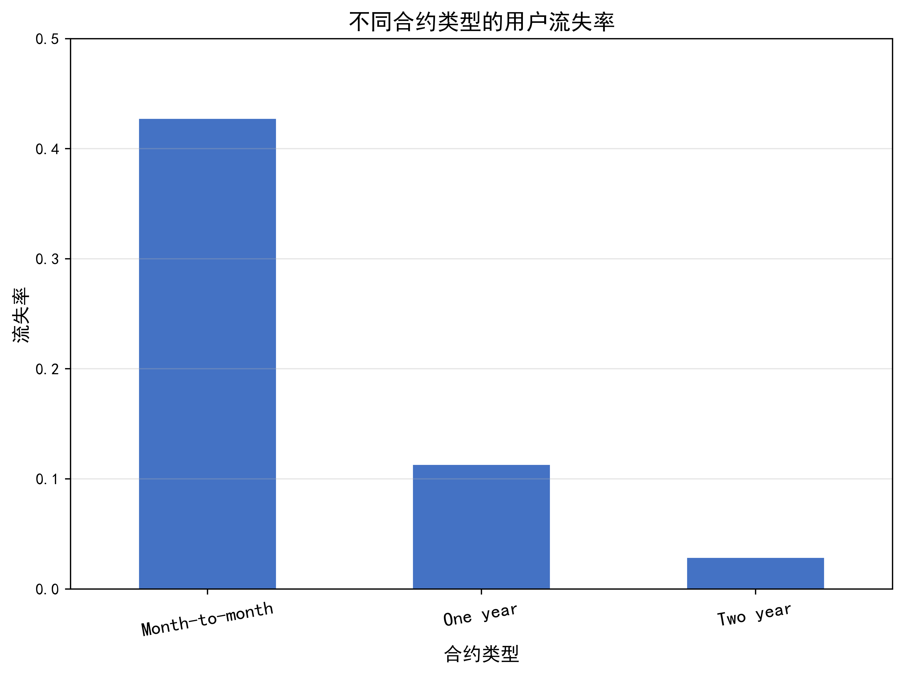
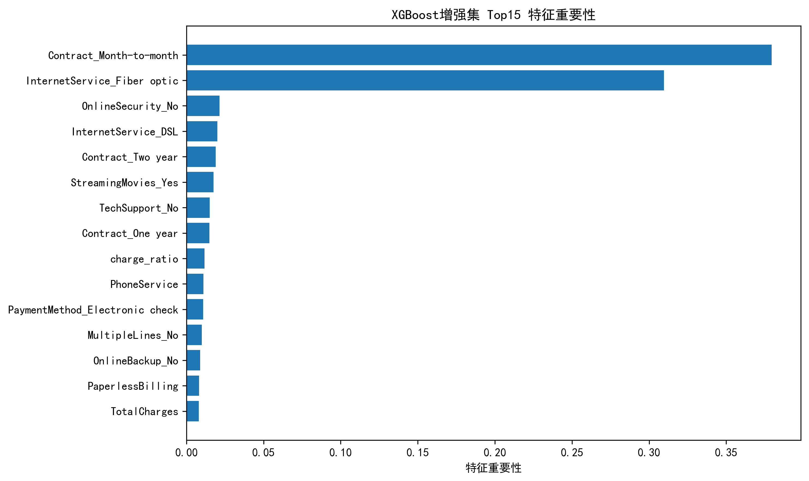
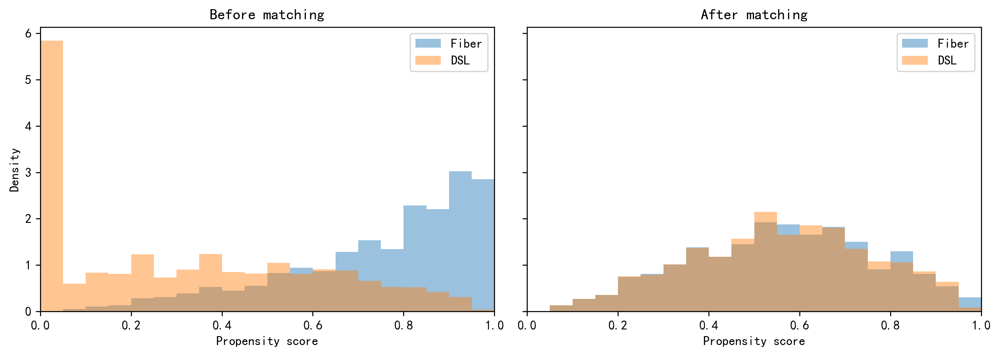
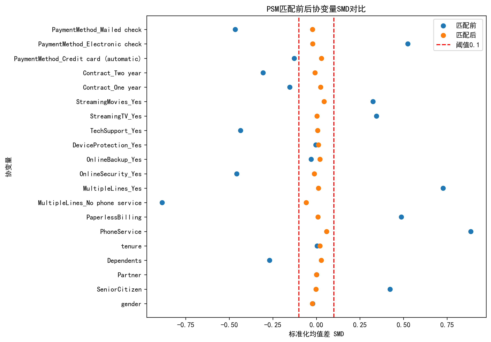

# churn-causal-analysis
Customer Churn Prediction with Causal Inference-用户流失预测与因果推断增强分析

> 使用逻辑回归和 XGBoost 预测电信客户流失风险，并通过倾向性得分匹配（PSM）比较光纤与 DSL 用户的协变量平衡。项目基于 Kaggle 的 Telco Customer Churn 数据集，以 Jupyter Notebook 组织分析流程。
>
[快速开始](#快速开始) · [预测结果](#流失预测) · [匹配分析](#倾向性得分匹配) · [仓库导航](#仓库导航)

## 快速开始
克隆仓库后，在仓库根目录执行以下命令。现有 [requirements.txt](requirements.txt) 中的 `packaging` 指向原环境的本地文件路径，以下命令直接安装 Notebook 使用的主要依赖。

```bash
conda create -n churn-env python=3.10
conda activate churn-env
python -m pip install jupyter pandas numpy matplotlib scikit-learn xgboost
cd notebooks
jupyter notebook
```

1. 从 Kaggle 的 Telco Customer Churn 数据集获取 `WA_Fn-UseC_-Telco-Customer-Churn.csv`，放入仓库根目录下的 `data/raw/`。
2. 按编号运行 Notebook，并保持内核工作目录为 `notebooks/`，以便正确解析相对路径。已有处理后的 CSV 时，可以直接运行第 03 或第 04 本 Notebook。
3. 图表中文字体使用 `SimHei`（黑体）。重新绘图时可安装该字体，或在当前 Notebook 会话中使用系统已有的中文字体。

## 数据与特征
公开 Kaggle 电信数据集 Telco Customer Churn
路径：data/raw/WA_Fn-UseC_-Telco-Customer-Churn.csv

- 样本总量：7043条用户数据；
- 特征数量：21个；
- 目标变量：`Churn`，标记用户是否流失（Yes=流失，No=留存）；
- 字段覆盖：用户基础信息、合约类型、宽带服务、增值业务、支付方式、月费、总费用等；

## 探索性分析
- 流失客户占 **26.54%**；
- **按月合约**用户流失率显著高于一年 / 两年合约，见[合约类型流失率](output/figures/contract_churn_rate.png)；
- **光纤宽带**用户流失率高于 DSL 和无宽带用户，见[宽带类型流失率](output/figures/internetService_churn_rate.png)；
- **电子支票支付**用户流失率在四种支付方式中最高，见[支付方式流失率](output/figures/paymentMethod_churn_rate.png)；


## 流失预测
1. 预处理将 `Churn` 编码为 1（流失）或 0（留存），删除客户 ID，将 `TotalCharges` 的空白值填为 0 后转为数值，并对分类变量编码。
2. 新增实际月均消费（avg_monthly_spend）、用户生命周期（user_life）、月度消费占比（charge_ratio）三个特征。
| 衍生特征            | 定义                                                |
| ------------------- | --------------------------------------------------- |
| `avg_monthly_spend` | 累计费用除以在网月数。在网月数为 0 时使用月费       |
| `user_life_stage`   | 按在网时长划分为 0–6 个月、7–24 个月、25 个月及以上 |
| `charge_ratio`      | 月费除以累计费用。累计费用为 0 时取 1               |
- 实际月均消费用来区分**套餐标价和用户实际平均扣费**，识别享受优惠、折扣的用户，这类用户流失行为和普通用户存在差异。
- 不同生命周期用户的流失动机、对优惠挽留活动敏感度差异明显，作为**分层变量**，用于异质性因果效应分析。
- 衡量用户短期价格压力，识别**短期高单价敏感用户**；同等月租下，在网时间越短该指标越高，这类用户更容易因价格因素流失。
## 相关性结论
- **合约类型是和流失关联最强的变量**：按月合约用户流失风险显著更高；合约周期越长，用户流失的倾向越低；当月费用占累计总费用比值高的用户更容易流失。
- **光纤宽带业务（Fiber optic）与流失正向强相关**：办理光纤宽带的客户流失风险更高，是仅次于合约类型的高风险因素；DSL 宽带、不办理宽带业务的用户流失风险相对更低。

- 增值服务呈现分化的相关性：在线安全、技术支持类服务和流失负相关，开通后流失概率更低；流媒体（电视、影视）增值服务和流失呈正相关，开通该类服务的用户更容易流失。
## 倾向性得分匹配
[因果分析 Notebook](notebooks/04_causal_analysis.ipynb) 从逻辑回归基线数据中筛选出 5,517 位宽带用户，以 3,096 位光纤用户为处理组、2,421 位 DSL 用户为对照组，结果变量为 `Churn`。代码用逻辑回归估计光纤使用倾向，排除月费与累计费用后纳入 27 个协变量，再以倾向得分距离 0.05 为卡钳进行 1:1 无放回最近邻匹配。倾向得分模型在拟合样本上的 AUC 为 0.8729。

倾向得分分布图展示了光纤组与 DSL 组在匹配前后的得分重叠情况。



1:1 匹配后共保留 **1,184 对、2,368 人**。光纤组保留 1,184 / 3,096 人（38.24%），DSL 组保留 1,184 / 2,421 人（48.91%）。

并保留了匹配前后的标准化均值差（SMD）图。图中显示的匹配后 SMD 均位于 ±0.1 内。


匹配后分别计算光纤组和 DSL 组的平均 `Churn`，得到两组流失率，并以两组流失率之差解释为处理组平均处理效应（ATT）。`att = 0.1394`结果表示，**在匹配后的样本中，使用光纤宽带，平均会让用户流失概率上升 13.94 个百分点**。

## 仓库导航
| 文件                                                         | 用途                                                         |
| ------------------------------------------------------------ | :----------------------------------------------------------- |
| [01_data_explore.ipynb](notebooks/01_data_explore.ipynb)     | 检查原始数据，绘制合约、宽带和支付方式的分组流失率           |
| [02_data_preprocess.ipynb](notebooks/02_data_preprocess.ipynb) | 清洗数据、编码、构建衍生特征并导出四份建模数据               |
| [03_baseline_model.ipynb](notebooks/03_baseline_model.ipynb) | 训练和评估四组模型，导出系数与特征重要性图                   |
| [04_causal_analysis.ipynb](notebooks/04_causal_analysis.ipynb) | 估计倾向得分、执行匹配并计算协变量平衡性指标                 |
| [src/data_process.py](src/data_process.py) · [src/model_utils.py](src/model_utils.py) | 数据清洗与编码、分层切分和评估指标                           |
| [data/processed/](data/processed/)                           | 四份处理后的 CSV，每份 7,043 行。逻辑回归基线版和增强版分别为 31 和 33 列，XGBoost 分别为 41 和 46 列，均含标签 |
| [output/](output/)                                           | 模型评估表、逻辑回归系数表及图表                             |